# Python Regular Expressions: Extracting Device IDs and Flagging IP Addresses

## Summary

In this lab from the Google Cybersecurity Certificate (Automate Cybersecurity Tasks with Python), I used Python regular expressions to extract device IDs that need an operating system update, then extracted IP addresses from a login log and checked them against a list of flagged addresses. The device IDs, usernames, login times, and IP addresses are sample data provided by the course.

## Tools Used

- Python 3
- Jupyter Notebook (course lab environment)
- The `re` module

## Skills Demonstrated

- Importing the `re` module
- Writing regular expression patterns with `\w`, `\d`, `\.`, `+`, and `{1,3}`
- Extracting every match from a string with `re.findall()`
- Tightening a pattern from exactly three digits per IP segment, to one or more digits, to between 1 and 3 digits
- Storing `findall` results in a list
- Membership checks with the `in` operator
- A `for` loop with `if`/`else` to compare extracted IPs against a flagged list

## Part 1: Extracting Device IDs That Need an Update

The first part of the lab starts with a log of device IDs stored in a string named `devices`. The IDs that begin with `r15` are running an operating system that must be updated, so the goal is to pull only those IDs out of the string.

**Task 1: import the `re` module.** Regular expressions in Python live in the `re` module. Importing it once makes functions like `re.findall()` available for the rest of the notebook. The cell produces no output.

```python
import re
```

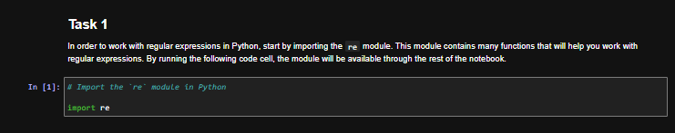

**Task 2: display the device log.** `devices` is a single string of space-separated alphanumeric IDs. Printing it shows the full log, including four IDs that start with `r15`: `r151dm4`, `r15xk9h`, `r15u9q5`, and `r159r1u`.

```python
devices = "r262c36 67bv8fy 41j1u2e r151dm4 1270t3o 42dr56i r15xk9h 2j33krk 253be78 ac742a1 r15u9q5 zh86b2l ii286fq 9x482kt 6oa6m6u x3463ac i4l56nq g07h55q 081qc9t r159r1u"

print(devices)
```

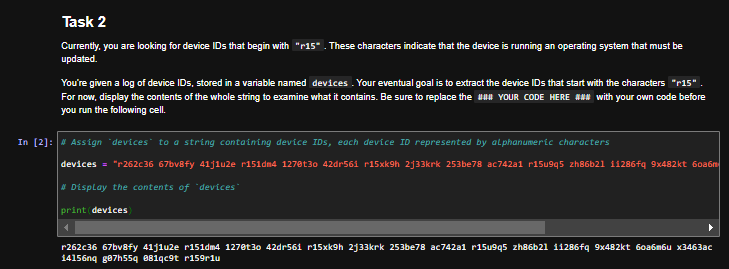

**Task 3: write a pattern for IDs that start with `r15`.** The pattern is stored in `target_pattern`. `\w` matches any letter, number, or underscore, and `+` means "one or more," so `r15\w+` matches `r15` followed by the rest of that device ID. This cell only assigns variables, so it produces no output.

```python
devices = "r262c36 67bv8fy 41j1u2e r151dm4 1270t3o 42dr56i r15xk9h 2j33krk 253be78 ac742a1 r15u9q5 zh86b2l ii286fq 9x482kt 6oa6m6u x3463ac i4l56nq g07h55q 081qc9t r159r1u"

target_pattern = "r15\w+"
```

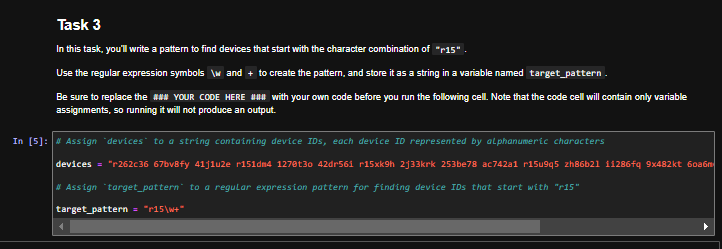

**Task 4: extract the matching IDs.** `re.findall()` applies `target_pattern` to `devices` and returns a list of every match. It finds all four `r15` devices: `r151dm4`, `r15xk9h`, `r15u9q5`, and `r159r1u`.

```python
devices = "r262c36 67bv8fy 41j1u2e r151dm4 1270t3o 42dr56i r15xk9h 2j33krk 253be78 ac742a1 r15u9q5 zh86b2l ii286fq 9x482kt 6oa6m6u x3463ac i4l56nq g07h55q 081qc9t r159r1u"

target_pattern = "r15\w+"

print(re.findall(target_pattern, devices))
```

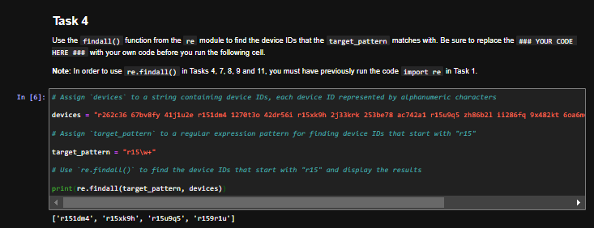

## Part 2: Extracting IP Addresses from a Login Log

The second part uses a network security log of login attempts, stored as a string named `log_file`. Each entry has a username, a date, a login time, and an IP address. The course notes that some addresses in the log are invalid because of issues in data collection. The goal is to extract the valid IP addresses with a regular expression.

```python
log_file = "eraab 2022-05-10 6:03:41 192.168.152.148 \niuduike 2022-05-09 6:46:40 192.168.22.115 \nsmartell 2022-05-09 19:30:32 192.168.190.178 \narutley 2022-05-12 17:00:59 1923.1689.3.24 \nrjensen 2022-05-11 0:59:26 192.168.213.128 \naestrada 2022-05-09 19:28:12 1924.1680.27.57 \nasundara 2022-05-11 18:38:07 192.168.96.200 \ndkot 2022-05-12 10:52:00 1921.168.1283.75 \nabernard 2022-05-12 23:38:46 19245.168.2345.49 \ncjackson 2022-05-12 19:36:42 192.168.247.153 \njclark 2022-05-10 10:48:02 192.168.174.117 \nalevitsk 2022-05-08 12:09:10 192.16874.1390.176 \njrafael 2022-05-10 22:40:01 192.168.148.115 \nyappiah 2022-05-12 10:37:22 192.168.103.10654 \ndaquino 2022-05-08 7:02:35 192.168.168.144"
```

**Task 5: display the log.** Printing `log_file` shows 15 login attempts. Most addresses look like ordinary IPv4 addresses, but several are clearly invalid, including `1923.1689.3.24`, `1924.1680.27.57`, `1921.168.1283.75`, `19245.168.2345.49`, `192.16874.1390.176`, and `192.168.103.10654`.

```python
print(log_file)
```

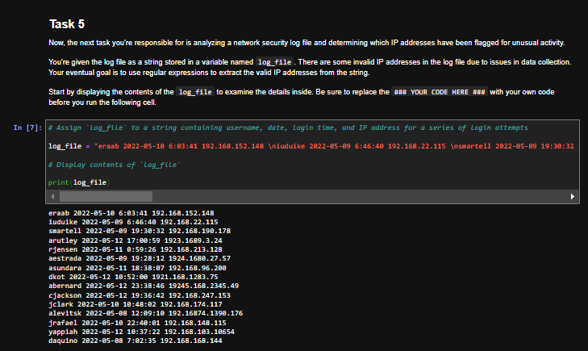

**Task 6: write a pattern for four groups of three digits.** A first attempt at an IP pattern looks for the form `xxx.xxx.xxx.xxx`. Each `\d` is one digit, and each `\.` is a literal period. The backslash matters because a plain `.` in a regular expression means "any character." This cell only assigns the pattern, so it produces no output.

```python
pattern = "\d\d\d\.\d\d\d\.\d\d\d\.\d\d\d"
```

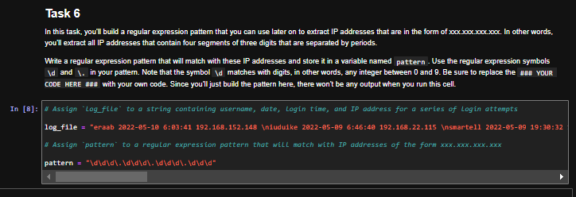

**Task 7: extract IPs with that pattern.** `re.findall(pattern, log_file)` returns eight addresses, all with exactly three digits in each segment:

`192.168.152.148`, `192.168.190.178`, `192.168.213.128`, `192.168.247.153`, `192.168.174.117`, `192.168.148.115`, `192.168.103.106`, and `192.168.168.144`.

It misses valid addresses with fewer than three digits in a segment, such as `192.168.22.115` and `192.168.96.200`. It also pulls `192.168.103.106` out of the invalid address `192.168.103.10654`, because the first 12 characters of that string still match four groups of three digits.

```python
pattern = "\d\d\d\.\d\d\d\.\d\d\d\.\d\d\d"

print(re.findall(pattern, log_file))
```

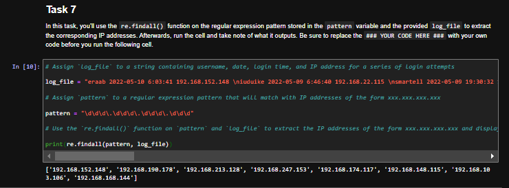

**Task 8: allow one or more digits in each segment.** Replacing each `\d\d\d` with `\d+` lets every group have one or more digits, so the pattern now catches IPs like `192.168.22.115`. The tradeoff is that it also grabs the invalid addresses, including `1923.1689.3.24` and `192.168.103.10654`, because `+` does not cap the number of digits.

```python
pattern = "\d+\.\d+\.\d+\.\d+"

print(re.findall(pattern, log_file))
```

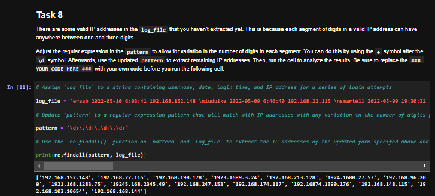

**Task 9: limit each segment to 1 to 3 digits.** Curly brackets set a range: `{1,3}` means between 1 and 3 of the character before it. The updated pattern is stored, `re.findall()` is run, and the result is saved in `valid_ip_addresses`:

```python
pattern = "\d{1,3}\.\d{1,3}\.\d{1,3}\.\d{1,3}"

valid_ip_addresses = re.findall(pattern, log_file)

print(valid_ip_addresses)
```

The obviously invalid addresses with more than three digits in a segment are gone, and the two shorter valid IPs are included. The list has 10 addresses. One leftover remains: `192.168.103.106` is a partial match from the invalid `192.168.103.10654`. That happens because `re.findall()` can match a valid-looking prefix inside a longer string when the pattern has no boundary around the address. That limitation is visible in the output and is left as is in this lab.

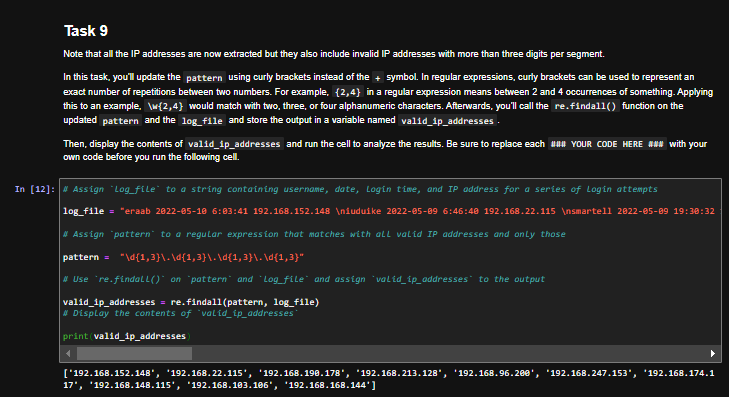

## Part 3: Checking Extracted IPs Against a Flagged List

**Task 10: display the flagged addresses.** The course provides a list of IP addresses that have already been flagged for unusual activity and should be investigated further. The lab notes that this list is for educational purposes and uses private IP addresses that appear only on internal networks. Printing it shows four addresses:

```python
flagged_addresses = ["192.168.190.178", "192.168.96.200", "192.168.174.117", "192.168.168.144"]

print(flagged_addresses)
```

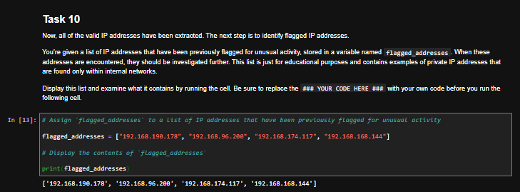

**Task 11: loop through the extracted IPs and flag matches.** A `for` loop walks through each address in `valid_ip_addresses`. The `in` operator checks whether that address is in `flagged_addresses`. If it is, the cell prints that it has been flagged for further analysis. Otherwise, it prints that it does not require further analysis.

```python
for address in valid_ip_addresses:
    if address in flagged_addresses:
        print("The IP address", address, "has been flagged for further analysis.")
    else:
        print("The IP address", address, "does not require further analysis.")
```

All 10 extracted addresses are checked. Four are flagged: `192.168.190.178`, `192.168.96.200`, `192.168.174.117`, and `192.168.168.144`. The other six, including the partial match `192.168.103.106`, are reported as not requiring further analysis.

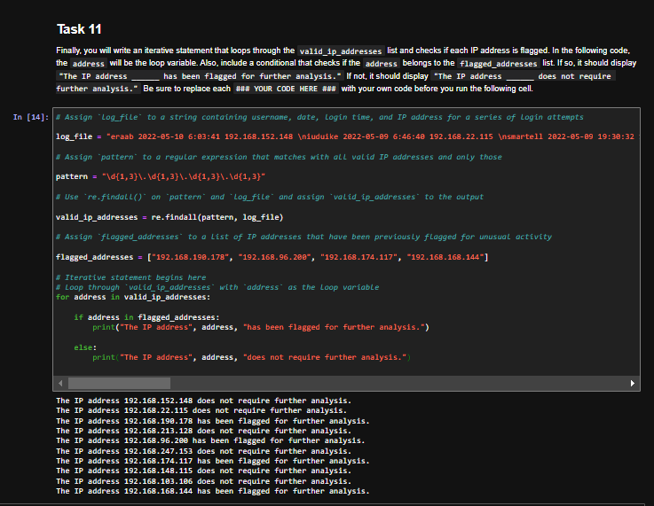

## Key Takeaways

- Importing the `re` module makes regular expression functions such as `re.findall()` available.
- `\w` matches a letter, number, or underscore, and `+` means "one or more," so a pattern like `r15\w+` can pull a specific set of device IDs out of a longer log string.
- `re.findall()` returns a list of every match, which is useful when a log contains many IDs or IP addresses.
- `\d` matches a digit, and `\.` matches a literal period. A plain `.` would mean "any character," so the backslash is required when the period in an IP address has to be exact.
- A pattern of exactly three digits per segment misses valid IPs with 1-digit or 2-digit groups. `\d+` catches those, but it also accepts invalid addresses with too many digits.
- `{1,3}` narrows each segment to between 1 and 3 digits, which removes most of the invalid addresses in this log.
- Without a boundary around the match, `re.findall()` can still return a valid-looking piece of a longer invalid string, which is why `192.168.103.106` appears as a leftover from `192.168.103.10654`.
- A `for` loop and the `in` operator can compare the extracted addresses to a watch list and print a different message for flagged and unflagged IPs.
- Automating this kind of extraction and comparison is a practical way to work through log data: pull out the values that match a pattern, then check them against addresses that need a closer look.
